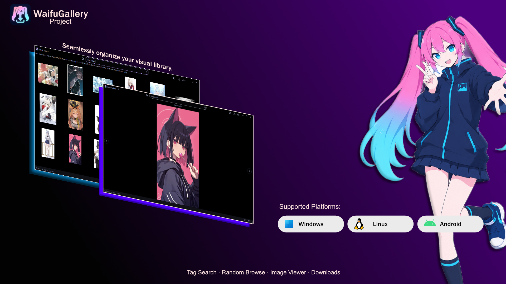

# Waifu Gallery

Waifu Gallery is an independent media browsing application with separate Windows, Linux, and Android implementations.

## Projects

- [Windows](windows/README.md) — Python and PySide6 desktop application (version 0.1.8).
- [Linux](linux/README.md) — Linux port aligned with the Windows 0.1.8 desktop feature set; platform runtime and packaging still need Linux verification.
- [Android](android/README.md) — Kotlin and Jetpack Compose mobile application (version 0.1.8).

The desktop and Android applications provide random browsing, tag search, provider and rating filters, media viewing, media information, and downloads. Feature availability and platform requirements are documented in each project README.

## Encrypted user data backups

Windows, Linux, and Android provide **Settings → Backup & Data** (on Android, in Preferences). Export creates a `.wgbak` file containing favorites, Gelbooru/Rule34.xxx credentials, and portable preferences such as provider, rating/content filters, search terms, DoH settings, media filter, ambient mode, and video resolution. Device-specific download locations and window state are excluded.

The shared version 1 format uses PBKDF2-HMAC-SHA256 (600,000 iterations) and AES-256-GCM. Choose a passphrase of at least 8 characters and keep it safe; there is no recovery option. Import validates and decrypts the entire file before writing anything. **Merge** adds missing favorites and keeps credentials already configured on the device; **Replace** replaces favorites and provider credentials. Both options import the backup's portable preferences. The local download location is retained.

This encrypts the exported file only. Provider credentials remain stored using each platform's existing local settings storage, so protect access to your device as usual.
Windows and Linux use app-styled dialogs and an in-app file browser for backup passphrases and file selection; Android uses its system document picker.

## Desktop UI behavior and bug reports

The Windows and Linux desktop apps share the same UI behavior: search cards show media without titles and scale small provider previews to fill their tiles; changing search pages clears old results while loading; zoom hides scrollbars but retains drag-to-pan; Search, Favorites, and Media Info use thin capsule scrollbars; and video buffering uses a bare spinner with gray controls/progress. Provider notices use gray capsules without a purple outline. The footer shows image/video counts on Search results and provider, media rating, and resolution for a loaded image in Random or a Search/Favorites detail; it clears while loading or outside those views. Media Info includes provider and rating. Favorites stays open while browsing its images, and the Back button is hidden in favorite-media details. Download history rows have a readable minimum height. Random-image metadata and search-loading overlays, plus desktop Settings opening, have been fixed.

When reporting a regression, include the OS, whether the media is an image or video, the exact steps to reproduce it, and a screenshot or error text. For desktop issues, check both `windows/waifu_gallery/ui/` and `linux/waifu_gallery/ui/`: changes to shared behavior should remain in sync. Run `python -m compileall` on the changed Python files and `git diff --check` before handing off a fix.

## Community

- See [CONTRIBUTING.md](CONTRIBUTING.md) for development setup and pull request guidance.
- Report security issues according to [SECURITY.md](SECURITY.md).

## License and credits

The Waifu Gallery application source code is licensed under the MIT License; see [LICENSE](LICENSE). Android also includes a copy at [android/LICENSE](android/LICENSE).

The general idea of browsing random waifu images was inspired by [NyarchLinux/WaifuDownloader](https://github.com/NyarchLinux/WaifuDownloader). Waifu Gallery is an independent implementation and does not include its GTK source or artwork.

Bundled toolbar SVGs in the Windows app are from [Lucide](https://github.com/lucide-icons/lucide); their ISC and Feather-derived MIT notices are in [LUCIDE-LICENSE.txt](windows/waifu_gallery/assets/LUCIDE-LICENSE.txt). The `waifugallery.png` artwork and images fetched from providers are not relicensed by the application MIT license; their rights remain with their respective creators.

Third-party libraries retain their own licenses. Review their respective license notices when redistributing builds.

## Support

If you would like to support Waifu Gallery's development, you can do so on [Ko-fi](https://ko-fi.com/calestinfisalia).
